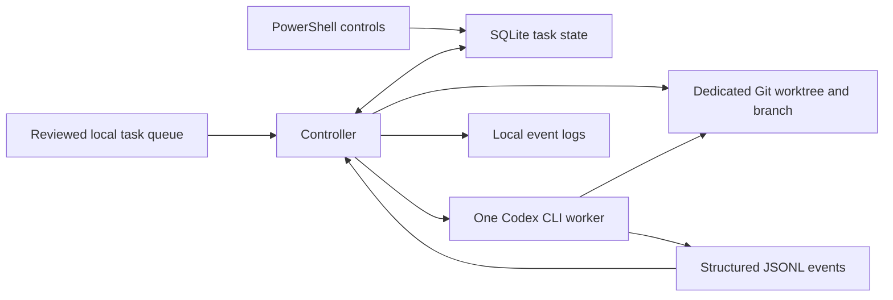

# Dallas Urbanists Agent Orchestrator

The orchestrator reads a local queue of reviewed tasks, starts one Codex CLI worker at a time, and saves the result of each run. Codex performs the work. The controller decides what can run next, gives each task its own Git branch and worktree, and keeps a local record so restarting the controller does not repeat a task.

## Set up on Windows

Install Node.js 24 or later, Git for Windows, and Codex CLI 0.163.0 or later. GitHub CLI is optional for operating the controller. From PowerShell in this checkout, run the following commands.

```powershell
npm ci
codex login status
npm run doctor
npm test
npm run dry-run
```

Run `codex login` if you need to sign in. The doctor checks whether the CLI and its saved login are available. The integration test verifies that the signed-in account can actually run both models. If the doctor cannot find Codex, set `$env:ORCHESTRATOR_CODEX` to the absolute path to the native `codex.exe`. The npm PowerShell and batch shims are unsuitable for this subprocess runner.

Dry-run mode reads the sample issue queue and prints the prototype's simulated Terra and Sol assignments. It does not start Codex or create branches or a state database. A real run always uses one worker, even though the sample plan simulates three slots.

## Run the disposable integration test

```powershell
$env:ORCHESTRATOR_LIVE_TEST = '1'
try { npm run test:integration } finally { Remove-Item Env:ORCHESTRATOR_LIVE_TEST }
```

This test makes real Codex requests and can consume usage. It creates a fresh local Git repository and gives Terra and Sol separate worktrees. It checks that both file edits stay in their assigned worktrees, that both workers return structured results, and that the controller dispatches Sol automatically after Terra. It also checks that reopening the state does not dispatch either task again. The Windows tests exercise cancellation and timeouts against a real subprocess with a child process. The test prints the disposable folders and retains them for inspection.

The live worker also runs a synthetic filesystem probe that should return access denied when it tries to overwrite a file beside the worktree under Windows Temp. If the sentinel changes or the probe cannot establish the denial, the integration gate fails. This checks one write boundary on the host. The Windows worker currently uses the legacy unelevated workspace-write sandbox. Read access and network isolation have different limits, so keep the integration on disposable data. [Codex Windows sandbox](https://learn.chatgpt.com/docs/windows/windows-sandbox)

On November 11, 2026, the disposable suite passed on Windows with Codex CLI 0.163.0, Node.js 24.22.1, and Git 2.50.1. The in-worktree writes succeeded and the sibling Temp write returned EPERM. This observation applies to the worker configuration used by the test.

## Run a reviewed local queue

Keep the initial real runs on disposable repositories. Leave Storytelling Studio and production checkouts outside the allowlist for this milestone. Use a trusted local queue file outside the task worktrees. Each task needs a unique positive number, an explicit `terra` or `sol` model, and a list of dependency numbers. A lower `priority` runs first. Ties go to the lower task number.

Save a queue such as the following as `queue.local.json`. Replace both paths with the absolute path of a disposable Git checkout that already has a commit.

```json
{
  "target": "C:/sandbox/disposable-demo",
  "allowedRepos": ["C:/sandbox/disposable-demo"],
  "issues": [
    {
      "number": 1,
      "title": "Add a demo note",
      "state": "ready",
      "model": "terra",
      "dependencies": [],
      "prompt": "Create demo.txt containing the text hello. Read it back to verify the edit."
    },
    {
      "number": 2,
      "title": "Add a second demo note",
      "state": "ready",
      "model": "sol",
      "dependencies": [1],
      "prompt": "Create second.txt containing the text world. Read it back to verify the edit."
    }
  ]
}
```

```powershell
npm run dry-run -- --queue queue.local.json --state .\state\demo
npm run start -- --queue queue.local.json --state .\state\demo --execute --limit 2 --timeout-seconds 300
```

For a local queue, dry-run lists tasks eligible now in dispatch order. Use the same state path for preview and execution so the preview accounts for previous task outcomes and pause or stop flags.

The controller snapshots the target's current committed HEAD at the start of each invocation. Every task in that invocation starts from that commit. A dependency's completion opens the scheduling gate. To use its edits as a later task's base, inspect and integrate them yourself before starting the later task. Use `--limit 1`, the default, when you need to review between tasks.

The allowlist matches the canonical checkout path. The controller keeps one state directory per checkout and requires it to sit outside the target checkout. It does not accept live GitHub issue bodies as executable tasks. It passes the operator-reviewed prompt as text on stdin, starts the CLI without a shell, and requests workspace-write with no approval escalation. The controller creates local branches only. GitHub issue polling, authenticated replies, PR automation, and unattended operation are future work.

## Pause, stop, and inspect

From another PowerShell window in the orchestrator checkout, use the same state path as the running controller.

```powershell
npm run status -- --state .\state\demo
npm run pause -- --state .\state\demo
npm run stop -- --state .\state\demo
Get-Content .\state\demo\logs\task-1.jsonl -Tail 20
```

Pause lets the current worker finish and prevents the next dispatch. Stop asks the controller to terminate the active process tree and prevents later dispatch. Ctrl+C asks the current controller to stop. On Windows, the controller uses `taskkill /T` for tree termination. On POSIX it signals the worker's process group and records an interruption because detached descendants may survive. Pause and stop set a durable control flag. Run `npm run unpause -- --state .\state\demo` and start the controller again when ready.

The controller stores task claims, timestamps, model, branch, worktree, PID, Codex session ID, terminal state, and diagnostic categories in SQLite. Logs record structured event types and exit codes. Raw prompts, command output, and the free-form model response are omitted from controller logs and the database. Codex keeps its own session record under the signed-in user.

A failed or blocked task leaves its worktree available if one was created. A controller logging or control-state failure ends the run. Dependencies wait, and independent tasks can continue within the run limit. The controller does not retry failed tasks automatically. After an abrupt restart, it marks the previous claim interrupted and holds dispatch because a worker might still be alive. Inspect the recorded worktree and PID, verify that the old worker and its children have exited, and then clear the hold with the following command. Acknowledging the interruption never reruns that task.

```powershell
node src/cli.js acknowledge 1 --state .\state\demo --confirm-process-exited
```

Worktrees remain available for inspection by default. Use `node src/cli.js cleanup 1 --state .\state\demo` to remove a completed, clean worktree after review. The command refuses modified, untracked, or ignored files and keeps the task branch.

## Architecture



## Glossary

| Term | Meaning |
| --- | --- |
| Controller | The Node.js program that checks dependencies, starts workers, and records results. |
| Worker | One noninteractive Codex CLI process assigned to a task. |
| Issue queue | The local list of reviewed tasks and their dependencies. |
| Worktree | A separate checkout tied to a task branch, with Git history shared with the target repository. |
| Lease | The SQLite lock that lets only one controller dispatch from a state directory at a time. |
| Blocker | A decision or condition that prevents the worker from finishing the task. |
| Integration gate | The disposable test that checks whether this host can run both models and enforce the tested restrictions. |
