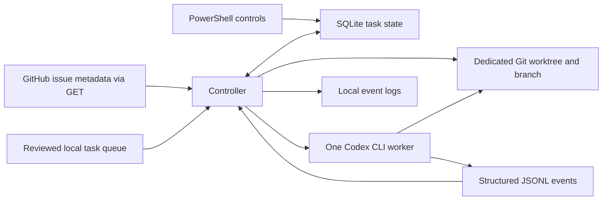

# Dallas Urbanists Agent Orchestrator

The orchestrator reads a local queue of reviewed tasks, starts one Codex CLI worker at a time, and saves the result of each run. Codex performs the work. The controller decides what can run next, gives each task its own Git branch and worktree, and keeps a local record so restarting the controller does not repeat a task.

## Set up on Windows

Install Node.js 24 or later, Git for Windows, and Codex CLI 0.163.0 or later. Install GitHub CLI if you want to poll GitHub issues. From PowerShell in this checkout, run the following commands.

```powershell
npm ci
codex login status
npm run doctor
npm test
npm run dry-run
```

Run `codex login` if you need to sign in. The doctor checks whether the CLI and its saved login are available. The integration test verifies that the signed-in account can actually run both models. If the doctor cannot find Codex, set `$env:ORCHESTRATOR_CODEX` to the absolute path to the native `codex.exe`. The npm PowerShell and batch shims are unsuitable for this subprocess runner.

Dry-run mode reads the sample issue queue and prints the prototype's simulated Terra and Sol assignments. It does not start Codex or create branches or a state database. A real run always uses one worker, even though the sample plan simulates three slots.

## Run the disposable integration test

```powershell
$env:ORCHESTRATOR_LIVE_TEST = '1'
try { npm run test:integration } finally { Remove-Item Env:ORCHESTRATOR_LIVE_TEST }
```

This test makes real Codex requests and can consume usage. It creates a fresh local Git repository, supplies fixture GitHub issue snapshots, and gives Terra and Sol separate worktrees. It checks that both file edits stay in their assigned worktrees, that both workers return structured results, and that the controller dispatches Sol automatically after Terra. It checks that Terra can pause for a decision while Sol completes independent work, then resume in its original worktree after an authorized fixture reply. Reopening the state leaves both completed claims and the unapproved issue alone. The Windows tests exercise cancellation, timeouts, and abrupt controller death against disposable subprocesses. The crash test verifies that a second controller cannot claim work while the first holds the lock, that a surviving worker keeps recovery on hold, and that only the independent queued task runs after recovery. The test prints the disposable folders and retains them for inspection.

The live worker also runs a synthetic filesystem probe that should return access denied when it tries to overwrite a file beside the worktree under Windows Temp. If the sentinel changes or the probe cannot establish the denial, the integration gate fails. This checks one write boundary on the host. The Windows worker defaults to the legacy unelevated workspace-write sandbox. Read access and network isolation have different limits, so keep the integration on disposable data. [Codex Windows sandbox](https://learn.chatgpt.com/docs/windows/windows-sandbox)

Set `ORCHESTRATOR_TEST_CHROME` to the absolute path of an installed Chromium executable to also run the Windows browser probe through a real worker. The probe checks a Node child process, a fresh browser profile, loopback navigation, and scratch cleanup. A profile write alone does not establish Chromium readiness.

To rerun only that probe after a host or Codex update, set the desired Windows sandbox implementation for the controller process. Supported values are `unelevated` (default), `elevated` (requires prior provisioning), and `mxc` (requires a compatible host and CLI). These modes all use workspace-write with network access disabled. Use a disposable target to validate your selected mode.

```powershell
$env:ORCHESTRATOR_LIVE_TEST = '1'
$env:ORCHESTRATOR_TEST_CHROME = 'C:/path/to/chromium/chrome.exe'
$env:ORCHESTRATOR_WINDOWS_SANDBOX = 'mxc'
try {
  node --test --test-name-pattern 'Chromium uses worktree-local scratch' integration/codex.test.js
} finally {
  Remove-Item Env:ORCHESTRATOR_LIVE_TEST, Env:ORCHESTRATOR_TEST_CHROME, Env:ORCHESTRATOR_WINDOWS_SANDBOX
}
```

On November 11, 2026, the disposable suite passed on Windows with Codex CLI 0.163.0, Node.js 24.22.1, and Git 2.50.1. The in-worktree writes succeeded and the sibling Temp write returned EPERM. This observation applies to the worker configuration used by the test.

## Run a reviewed local queue

Keep the initial real runs on disposable repositories. Leave Storytelling Studio and production checkouts outside the allowlist for this milestone. Use a trusted local queue file outside the task worktrees. Each task needs a unique positive number, an explicit `terra` or `sol` model, and a list of dependency numbers. A lower `priority` runs first. Ties go to the lower task number.

Save a queue such as the following as `queue.local.json`. Replace both paths with the absolute path of a disposable Git checkout that already has a commit.

```json
{
  "target": "C:/sandbox/disposable-demo",
  "allowedRepos": ["C:/sandbox/disposable-demo"],
  "issues": [
    {
      "number": 1,
      "title": "Add a demo note",
      "state": "ready",
      "model": "terra",
      "dependencies": [],
      "prompt": "Create demo.txt containing the text hello. Read it back to verify the edit."
    },
    {
      "number": 2,
      "title": "Add a second demo note",
      "state": "ready",
      "model": "sol",
      "dependencies": [1],
      "prompt": "Create second.txt containing the text world. Read it back to verify the edit."
    }
  ]
}
```

```powershell
npm run dry-run -- --queue queue.local.json --state .\state\demo
npm run start -- --queue queue.local.json --state .\state\demo --execute --limit 2 --timeout-seconds 300
```

For a local queue, dry-run lists tasks eligible now in dispatch order. Use the same state path for preview and execution so the preview accounts for previous task outcomes and pause or stop flags.

The controller snapshots the target's current committed HEAD at the start of each invocation. Every task in that invocation starts from that commit. A dependency's completion opens the scheduling gate. To use its edits as a later task's base, inspect and integrate them yourself before starting the later task. Use `--limit 1`, the default, when you need to review between tasks.

The allowlist matches the canonical checkout path. The controller keeps one state directory per checkout and requires it to sit outside the target checkout. It does not accept live GitHub issue bodies as executable tasks. It passes the operator-reviewed prompt as text on stdin, starts the CLI without a shell, and requests workspace-write with no approval escalation. The controller creates local branches. PR automation is future work.

Every worker attempt receives a fresh scratch directory at the root of its worktree. The runner sets `TEMP`, `TMP`, and `TMPDIR` for sandboxed commands so tools such as Chromium can create profiles there. Harnesses can use `ORCHESTRATOR_WORKER_TEMP` to restore those variables inside the test process if the sandbox supplies its own Temp values. The runner removes scratch after confirmed exit and retains it for inspection when termination is uncertain. The system Temp exclusion stays enabled. Terra runs at medium reasoning and Sol runs at high reasoning.

On the pilot host, legacy unelevated workers could write to scratch. Node child processes with piped output returned `spawn EPERM`, while file-backed output worked. Chromium started with file-backed output and created a profile, then exited with access-denied errors from Crashpad and Mojo IPC before navigation. In a disposable MXC comparison, Node started and profile creation passed, but Chromium still exited before navigation. The same Chromium build loaded the disposable loopback page outside Codex with Chromium's own sandbox enabled. With the browser binaries copied into a disposable MXC workspace, Chromium created a profile but its Crashpad registration pipe closed before navigation. Chromium Headless Shell also exited before navigation. The installed desktop CLI's elevated probe failed at startup with `registered Core launch requires an installed app`. Real worker probes also failed in MXC and elevated modes. MXC reported an access-denied exit. Elevated mode could launch machine-installed Chrome, but its GPU subprocess repeatedly failed before navigation. The same failures reproduced with disposable Codex CLI 0.169.0 on Windows 11 build 26300.9974. Playwright Chromium 156.0.8078.4 returned access denied in MXC. Machine-installed Chrome 157.0.8103.52 reported a closed Crashpad registration pipe in MXC and repeated GPU subprocess exits in elevated mode. Node launch and worktree-local profile creation passed in each probe.

A separate Node-only comparison on the same Windows build used Codex CLI 0.169.0 with the managed workspace permission profile and two Node processes inside the disposable directory. The host control passed both a TCP loopback exchange and a local named-pipe exchange. Unelevated mode passed TCP and failed the pipe exchange. MXC passed the pipe exchange and failed TCP. Elevated mode passed both. These checks isolate basic IPC behavior. They do not reproduce Chromium's Crashpad registration or GPU subprocess startup. Browser verification remains a coordinator step on that host.

## Poll GitHub issues and claim reviewed work

Sign in to GitHub CLI with `gh auth login` if needed. The poll command lists issue metadata using paginated GET requests. It omits pull requests and raw issue bodies and works without a target checkout.

```powershell
npm run poll -- --repo DallasUrbanists/agent-orchestrator
npm run poll -- --repo DallasUrbanists/agent-orchestrator --polls 3 --interval-seconds 15
```

A runnable issue needs the `agent:ready` label and exactly one of `model:terra` or `model:sol`. Optional priority labels are `priority:p0`, `priority:p1`, and `priority:p2`. An issue body can declare same-repository dependencies on one line such as `Depends on: #12, #13`. An issue closed as completed, an open issue labeled `agent:done`, or a completed local claim can satisfy a dependency. Missing or unresolved dependencies hold the dependent task. Conflicting labels and invalid dependency declarations hold the affected issue.

For real work, save a reviewed queue with `sourceRepo` and a local prompt for each approved issue number. Use a disposable Git checkout whose `origin` points to the same repository on github.com.

```json
{
  "target": "C:/sandbox/disposable-demo",
  "allowedRepos": ["C:/sandbox/disposable-demo"],
  "sourceRepo": "example-org/disposable-demo",
  "issues": [
    {
      "number": 12,
      "prompt": "Create demo.txt containing the text hello. Read it back to verify the edit."
    }
  ]
}
```

```powershell
npm run dry-run -- --queue queue.local.json --state .\state\github-demo
npm run start -- --queue queue.local.json --state .\state\github-demo --execute --limit 2 --polls 3 --interval-seconds 15
npm run status -- --state .\state\github-demo
```

The GitHub-backed controller refreshes issue metadata before each dispatch. It uses the local prompt verbatim as task content and uses GitHub metadata for readiness, model, priority, and dependencies. For a run, `--polls` limits consecutive polls with no eligible work and defaults to one. `--interval-seconds` is the delay between those idle polls. For transient GitHub issue-read failures, the controller retries after 5, 15, and 60 seconds. It waits for a fresh issue snapshot before dispatch. Authentication, rate-limit and malformed-response failures stop the run and preserve existing claims.

The controller binds the state directory to the checkout and `sourceRepo`. It records each issue claim in SQLite before creating the worktree or launching Codex. Keep using the same state directory on this machine. A task stays claimed across polls and restarts even if GitHub still shows it as ready. Local claims coordinate controllers that share this state directory. With the default options, GitHub operations are issue-list GET requests.

### Require accepted, integrated prerequisites

For a supervised queue that requires accepted work on the integration branch, add an `acceptedPrerequisites` array. Use an empty array when no prerequisites have been accepted yet. After verifying a prerequisite's checks and integration, record its issue number and the full commit SHA from the integration branch.

```json
"acceptedPrerequisites": [
  { "number": 5, "commit": "0123456789abcdef0123456789abcdef01234567" }
]
```

Start the controller from a checkout of the reviewed integration branch. The runner verifies that each listed commit is in the exact history used to create new worktrees. Each approved issue in a GitHub-backed queue must specify a reviewed `dependencies` array in this mode. Use `[]` for an issue with no prerequisites. The controller uses this array even when the GitHub issue body has no numeric dependency list. A GitHub issue state or a worker's local result cannot release dependent work in this mode. A receipt also prevents the accepted issue from dispatching again. The coordinator supplies the receipts and is responsible for matching the issue to the correct integrated change. Restart the run after updating the checkout and receipts. A blocked worktree must already contain the accepted prerequisite commits before it can resume. Use a new state directory when first switching an existing queue to this prerequisite policy.

### Keep dispatch running across supervised merges

Start with a dedicated checkout of local `main`, a reviewed queue with `acceptedPrerequisites` (use `[]` for a new queue), and a separate JSON file containing the current full receipt array. Keep the file outside the target checkout and controller state directory.

```powershell
npm run start -- --queue queue.local.json --state .\state\github-demo --execute --watch-acceptance acceptance.json --limit 2 --polls 240 --interval-seconds 15
```

After reviewing the worker output and checks, the supervising coordinator merges the accepted change and advances the dedicated checkout's local `main`. Then replace the acceptance file atomically with the complete receipt array, including the new merged commit. The controller checks ancestry against the refreshed `main` and creates the dependent worktree from that exact commit. It stops on a non-fast-forward change or a receipt that is removed, changed, or outside the base history. The journal carries the last observed base and receipts across restarts. A later run without the watcher still has to include those receipts and use a descendant of that base. A GitHub merge becomes visible after the coordinator updates the local checkout. The controller does not fetch or merge automatically in this mode. The dispatch and idle poll limits still apply.

For a run that should stay available while waiting for a supervised merge or a
GitHub reply, use `--continuous` with `--execute`. The controller keeps polling
when no issue is eligible. It still exits at the configured `--limit`, on Pause
or Stop, or when a hold or error requires reconciliation. Use the same state
directory and acceptance file when restarting.

### GitHub issue intake with coordinator approval

This mode discovers open issues on every poll, including issues opened after the controller starts. Use a dedicated checkout and a single persistent state directory. The local configuration identifies the target and coordinator. Each task comes directly from its GitHub issue, without an entry in an `issues` array or an approval label.

Verify your numeric GitHub ID before configuring the coordinator.

```powershell
gh api --method GET user --jq '{login,id}'
```

Save a configuration such as the following for your disposable repository. Hexel's verified coordinator ID is `24529106`.

```json
{
  "target": "C:/sandbox/disposable-demo",
  "allowedRepos": ["C:/sandbox/disposable-demo"],
  "sourceRepo": "example-org/disposable-demo",
  "githubIntake": { "coordinatorId": 24529106 },
  "acceptedPrerequisites": []
}
```

- The coordinator's own open issue is approved at creation. A coordinator-authored issue stays self-approved while GitHub identifies the coordinator as the author and as the actor behind its latest title and body edits.
- For a third-party issue, or a coordinator issue whose latest title or body edit is from another actor, review the current title and body and post exactly `/orchestrator approve` in a new comment. The controller compares GitHub account IDs. Edits to the title or body invalidate earlier comments, even if the issue is reverted to the previous text. When GitHub reports an edit and a comment at the same timestamp, post a new comment. Edited, hidden, and deleted comments do not approve work.
- A generic issue defaults to Terra at medium reasoning. It can declare same-repository prerequisites with `Depends on: #12, #13`. The controller also recognizes Storytelling Studio's baseline dispatch table and linked numeric prerequisites, including Terra at high reasoning and Sol at high reasoning. It holds unsupported or ambiguous metadata, including conditional tasks, alternative prerequisites, native GitHub blockers, and stable prerequisite IDs with no matching link. Intake has one worker slot and uses isolated worktrees. Coordinate any separate workers or supervisors that share project resources.
- An approved issue can wait in the queue. Only the supervising coordinator's acceptance receipt for each prerequisite, verified against the fetched `main` history, releases the issue. GitHub issue closure and local worker success do not count as acceptance.

Dry-run previews show admitted issues, issues awaiting approval, and issues held for unsupported metadata. The preview checks receipts against the checkout's current `HEAD`, so update the dedicated checkout before previewing integrated work.

```powershell
npm run dry-run -- --queue intake.local.json --state .\state\intake-demo
```

For a real run, initialize a separate `acceptance.json` with `[]` or the current receipt array. Keep it outside both the target checkout and the state directory. After reviewing and merging a change, atomically replace the file with the full cumulative receipt array. Each receipt identifies the accepted issue number and the full commit SHA from `main`. The controller fetches `origin/main` itself, leaves the dedicated checkout's working files in place, and starts the next eligible issue from the fetched commit. Keep the controller running within the poll and execution limits.

```powershell
npm run start -- --queue intake.local.json --state .\state\intake-demo --execute --watch-acceptance acceptance.json --limit 2 --polls 240 --interval-seconds 15
npm run status -- --state .\state\intake-demo
```

To switch an existing local journal to intake, stop its controller after owned
work finishes and run the intake command with `--adopt-local-intake` once.
Use the same checkout, state directory, and cumulative acceptance receipts.
The controller checks the checkout and receipts before changing the binding.
Existing claims keep their worktrees and history. Finish pending local repairs
and handoffs before switching. To preserve an additional reviewed prerequisite,
set `githubIntake.requiredPrerequisites` to a map from issue number to extra
prerequisite issue numbers. These entries can add requirements to GitHub issue
metadata.

The SQLite claim records the issue ID, the approved revision hash, the coordinator ID, the approval comment ID when applicable, and the dispatch base. The same journal prevents a claimed issue from running again across polls and restarts, even after a fresh approval. Keep the journal and worktree paths when restarting. The controller also keeps the last verified base and receipts and rejects a rewind or removed receipt. Intake reads GitHub with GraphQL queries. With no write options enabled, it
only reads. To enable authorized decision replies in the same run, add
`--github-decisions`, set `authorizedResponders` to the approved numeric IDs,
and add an `intakeDecisions` array in the trusted queue configuration. Each
entry has a GitHub issue `number`, its reviewed `revision` from the dry-run
output, and a `decisions` array using the decision template format below.
This configuration supplies decision options. Issue discovery and approval
still come from GitHub.

An intake decision resumes the claim in its existing worktree only while
the issue is approved at the original revision and the saved template still
matches the local configuration. An edit or a replacement template holds
that claim even if an authorized reply already exists. A newly approved
revision does not rerun an existing claim.

Run the intake loop against a disposable bare Git origin with fixture GitHub responses and real Codex workers on Windows.

```powershell
$env:ORCHESTRATOR_LIVE_INTAKE = '1'
node --test test/intake.test.js
Remove-Item Env:ORCHESTRATOR_LIVE_INTAKE
```

### Publish issue status and worker progress

Use `--github-status` on a real run to enable status updates. For a local queue, set `"statusRepo": "OWNER/REPO"` to the checkout's GitHub origin and include the issues to report in the queue. The controller keeps the existing local journal binding and records the reporting repository separately. Sign in to `gh` as the publisher with issue write access and pull request read access. Create the `in-progress`, `in-review`, and `blocked` labels before enabling this option. The controller manages those three labels and preserves all others.

A confirmed worker launch sets `in-progress` and creates one comment for that attempt. The controller edits it every five minutes during the attempt and on exit. It includes elapsed time, the last event observed, and a short description of that event when available. Raw worker text, command output, and credentials stay out of the comment. A quiet update reports the lack of observed activity. If a decision resumes a task, the new worker attempt gets its own comment.

A task that needs intervention gets `blocked`. Local completion clears `in-progress` and records that a PR handoff is pending. The controller discovers a matching open PR from the recorded worktree branch into the same repository's `main` on the next reconciliation. It sets `in-review` and edits the last attempt comment to link the PR. To record the handoff immediately with the controller stopped, run:

```powershell
node src/cli.js handoff 12 --pr 34 --state .\state\intake-demo
```

The same state directory preserves progress comment IDs across restarts. Start with `--github-status` again or reconcile existing claims without dispatch:

```powershell
node src/cli.js sync-status --state .\state\intake-demo
node src/cli.js sync-status 12 --state .\state\intake-demo
```

Reconciliation retries label and comment edits and looks for an existing comment by its attempt marker and publisher account. If GitHub rejects a create request, the controller can retry. If the response is lost and GitHub has yet to show the comment, the controller reports unconfirmed delivery and keeps looking on later polls. It does not blindly post a second comment. A missing local claim leaves the issue alone. To reconcile one issue from an older local queue, run `sync-status N --repo OWNER/REPO`. The controller verifies the saved checkout's GitHub origin and leaves the queue binding in place. Review a running claim through the original journal before using this mode. Keep GitHub credentials in the controller's `gh` context.

### Publish verified work for review

Add a trusted `publication` object to a real run's queue to let the coordinator
commit and publish verified work. Use the same GitHub repository as the saved
checkout's fetch and push origin. Keep accepted prerequisites enabled. In the
coordinator account, authenticate Git push and `gh` with pull request and issue
write permissions.

```json
"publication": {
  "repo": "example-org/disposable-demo",
  "issues": [{ "number": 7, "paths": ["apps/renderer/src/", "tests/renderer/", "package-lock.json"] }]
}
```

Specify exact files or directories ending in `/`. For newly completed work,
configure the approved technical verifier for that issue. The controller checks
the scope and snapshots the content before and after that verifier. A worker's
self-reported success alone does not publish a PR. A verifier dispatched after
a technical blocker follows the same publication path on success.

To publish an already completed saved task without rerunning implementation,
add `verified` to its reviewed scope with `base` (the original commit),
`tree` (the content tree independently verified for this task), and `summary`
(the reviewed verification evidence safe to publish on GitHub). Use the same
journal. The `captureVerifiedTree` helper calculates the candidate tree ID
from the recorded worktree claim and base using a temporary Git index.
Compare the captured tree with the work you verified before authorizing publication.
For GitHub intake, the issue must still be approved at the revision recorded in
its claim. An issue edit or removed approval holds publication, including after
restart. A fresh approval for a different revision leaves the original claim held.

The controller saves the verified tree and commit before pushing the task
branch. It looks up the matching PR before creating one and records the issue
link once. If delivery is uncertain, the next run checks the remote state
before retrying. Review pending handoffs in `status`. The coordinator still
owns merge approval. Dependents wait for an accepted merge receipt.

### Check a supervised merge

A coordinator can check a reviewed PR with `check-merge`. Save a trusted
`merge-evidence.json` containing the GitHub repository, the exact reviewed
`head` commit, current `base` commit, numeric `reviewerId`, and a
`requiredChecks` array. Each check entry has its exact `name` and GitHub
`appId`. Pass the PR number separately.

```powershell
node src/cli.js check-merge 34 --merge-evidence merge-evidence.json
```

The command reads GitHub and reports the observed result. It requires an open
non-draft PR into `main`, exact-head approval by the specified reviewer,
successful checks from the configured apps, and a head that contains the
current base. It reads the PR and base again before reporting. GitHub can
change after the final read. The coordinator still owns the merge, and
unattended merges require server-side branch protections.

### Verify browser-dependent issues on the Windows host

Configure a hash-pinned, coordinator-owned script outside the target checkout
and state directory. The script checks its toolchain and uses exit 0 for a pass,
10 for a code failure, and 11 for unavailable host tooling. Keep it under a
trusted path and pass only coordinator-reviewed profiles to it.

```json
"technicalRecovery": {
  "limit": 2,
  "hostVerification": {
    "runner": { "path": "C:/reviewed/project-checks.mjs", "sha256": "<SHA-256>" },
    "toolchain": { "node": "C:/pinned/node.exe", "npm": "C:/pinned/npm-cli.js", "chrome": "C:/pinned/chrome.exe" },
    "profiles": { "full-render-decode": "Rendered and decoded both approved formats." },
    "issues": [{ "number": 8, "profile": "full-render-decode" }]
  }
}
```

The script receives `orchestratorProfile` and `orchestratorToolchain` as constants. The example in
`fixtures/host-verifiers/storytelling-render.mjs` checks the pinned Storytelling
Studio toolchain. The export command retains media and per-run receipts under
`out/verification/`. The verifier keeps decode logs and its summary under
`.local/`. Exclude these output paths locally before enabling publication. Each profile description
is reviewed evidence text for the handoff. After a pass, a profile can also write
one JSON array of measured checks to standard output. Each check has a
`name` and a `measurements` object containing integers or SHA-256 values.
Keep human-readable diagnostics in local files. The controller validates this
array before adding the measured checks to the verified-tree receipt and PR.
Issue text and worker output cannot
supply a command or choose a host profile. A bound issue gets host verification
after a worker reports completion or after an environment blocker is recovered.
If a code repair leaves browser verification to the host, the controller runs
that check within the repair attempt's remaining time and records its outcome.
Enable publication for the issue to bind the verification to the scoped Git tree
and include the verification in the review PR. The original worktree and retry
budget survive restart.

### Recover from technical blockers

Add `"technicalRecovery": { "limit": 4 }` to the reviewed queue to let the
controller start bounded repairs in the original worktree. The controller runs
independent eligible work first. It saves the number of recovery attempts and
uses a 60-minute cumulative worker budget. A changed task scope, an unavailable
worktree, or exhausted budget holds the task. Dependencies still require the
configured acceptance receipts from merged history.

The default is four attempts. Explicit limits from one to four still apply.
After exhausting the attempts or active time, the issue waits two hours from
its latest attempt completion. The next eligible poll renews both budgets in
the same worktree. The journal retains the claim, attempt history, and used
one-time authorizations. Use continuous polling to resume while the queue is idle.

For environment blockers, also add `verifier` inside `technicalRecovery`.
Set `number` to the issue the runner verifies. Set `path` to an absolute path to an operator-reviewed standalone Node module
outside the target and state directories. Set `sha256` to the lowercase hash
returned by `Get-FileHash -Algorithm SHA256`. The controller verifies the bytes
and supplies them directly to Node. A missing, unreadable, or changed runner
holds its issue before spending a recovery attempt. Other eligible work continues. The verifier runs on the controller host
with the preserved worktree as its working directory and a filtered
environment. It has the host account's filesystem permissions, so approve only
trusted verification code and the tools it invokes. Keep worker-provided
commands, repository code that has yet to be reviewed, and credentials out of
that runner.

Exit zero means verification passed. Exit 10 means the verifier found a code
failure that a Codex repair can address. Other exits mean the verification
environment failed. If a repair reports success and a verifier is configured for that issue,
the controller runs the verifier again before marking that attempt complete.
Status shows held recoveries and their reasons. After the owner authorizes a
final host-only verification of an exhausted environment blocker, use
`--execute --limit 1 --final-host-verification ISSUE:ATTEMPT` with the same
queue and journal. Find the latest attempt ID with `attempts`. The controller
requires a reviewed host profile and publication scope, records the extra
attempt once, and preserves the existing retry history and time budget.

Run the disposable D1-07-inspired acceptance test on Windows:

```powershell
$env:ORCHESTRATOR_LIVE_RECOVERY = '1'
node --test test/technical-recovery.test.js
Remove-Item Env:ORCHESTRATOR_LIVE_RECOVERY
```

This test models the Chromium `spawn EPERM` and missing Remotion bundler
`4.0.542` reported in the receipt. The fixture verifier simulates the approved
runner's result. The gated run launches a real Codex repair in that same fixture
worktree, without requiring another session from the operator. The test holds
issue #8 until #7 is merged and accepted. Running this test leaves the real
Storytelling Studio worktree and journal untouched.

For a pre-existing blocked claim, the coordinator can explicitly classify it
with `"adopt": [{ "number": 7, "kind": "environment" }]` inside
`technicalRecovery`. Adoption uses the original journal and worktree, excludes
pending human decisions, and never resets the recovery counter.

## Ask for a decision on GitHub

Enable issue comments explicitly with `--github-decisions` on a real run. Use a GitHub-backed queue, a signed-in `gh` account with permission to comment on the target issues, and a local list of authorized GitHub account IDs. To find an account ID, run `gh api users/LOGIN --jq .id` and verify the account before adding it.

Add `authorizedResponders` to the queue. For a queue with reviewed issue entries, add decisions as shown below. For GitHub issue intake, put the same decision templates in the revision-bound `intakeDecisions` entries. The worker can select each reviewed key once. GitHub receives the question, choice labels, and exact reply commands. Choice instructions stay local until the controller sends the chosen instruction to Codex.

```json
{
  "target": "C:/sandbox/disposable-demo",
  "allowedRepos": ["C:/sandbox/disposable-demo"],
  "sourceRepo": "example-org/disposable-demo",
  "authorizedResponders": [12345678],
  "issues": [
    {
      "number": 12,
      "prompt": "Build the draft index and ask for a layout decision before finishing.",
      "decisions": [
        {
          "key": "layout",
          "question": "Which layout should the draft index use?",
          "choices": [
            { "id": "list", "label": "List", "instruction": "Finish the draft using the reviewed list layout." },
            { "id": "grid", "label": "Grid", "instruction": "Finish the draft using the reviewed grid layout." }
          ]
        }
      ]
    }
  ]
}
```

```powershell
npm run start -- --queue queue.local.json --state .\state\github-demo --execute --github-decisions --limit 4 --polls 20 --interval-seconds 15
npm run status -- --state .\state\github-demo
```

The controller saves the blocked claim and request together, then posts the reviewed question on the issue. Independent tasks can run while the controller waits. From GitHub on mobile or desktop, add a new comment containing exactly one command from the request. The controller records the first matching, unedited reply from an authorized account. Before resuming, it checks the request and reply again against GitHub and the current account allowlist. If the saved reply was deleted, edited, or lost authorization, a newer valid reply can replace it. If GitHub comments are unavailable, the task stays blocked while unrelated eligible work can continue. Each resumption starts a fresh Codex session in the original worktree with all approved choice instructions saved for that task, in request order. The issue must remain ready, retain its applicable approval, and satisfy its dependencies. A successful resumption counts toward `--limit`. When the run reaches its poll limit, use the same command and state directory to check for replies again.

If a comment request times out, the controller checks later polls for the original message from the publishing account. Status shows `delivery-unconfirmed` when that check cannot confirm delivery. If you have inspected the issue and verified that the request was never posted, rearm that request with `node src/cli.js retry-decision REQUEST-ID --state .\state\github-demo`, then run the controller again. It checks for the original comment before posting. Keep the same signed-in publishing account during recovery.

## Pause, stop, and inspect

From another PowerShell window in the orchestrator checkout, use the same state path as the running controller.

```powershell
npm run status -- --state .\state\demo
npm run pause -- --state .\state\demo
npm run stop -- --state .\state\demo
Get-Content .\state\demo\logs\task-1.jsonl -Tail 20
```

Pause lets the current worker finish and prevents the next dispatch. Stop asks the controller to terminate the active process tree and prevents later dispatch. Ctrl+C asks the current controller to stop. On Windows, the controller uses `taskkill /T` for tree termination. On POSIX it signals the worker's process group and records an interruption because detached descendants may survive. Pause and stop set a durable control flag. Run `npm run unpause -- --state .\state\demo` and start the controller again when ready.

The controller stores task claims, timestamps, model, branch, worktree, PID, Codex session ID, terminal state, and diagnostic categories in SQLite. Logs record structured event types and exit codes. Controller logs and the database omit raw worker prompts, command output, and free-form model responses. Decision records retain the locally reviewed template, chosen option, and GitHub comment and responder IDs. Codex keeps its own session record under the signed-in user.

Run `node src/cli.js attempts --state .\state\demo` to inspect the durable attempt history for new dispatches. Each attempt records its base commit, model, log, process and session identifiers, and final outcome. Resuming a decision creates another attempt and preserves the earlier receipt. Existing task records remain readable after upgrade; history that predates this schema is unavailable.

A failed or blocked task leaves its worktree available if one was created. A controller logging or control-state failure ends the run. Dependencies wait, and independent tasks can continue within the run limit. The controller does not retry failed tasks automatically. After an abrupt restart, it marks the previous claim interrupted and holds dispatch because a worker might still be alive. Inspect the recorded worktree and PID, verify that the old worker and its children have exited, and then clear the hold with the following command. The acknowledgment command refuses to proceed if the recorded worker PID is still present or cannot be checked. A PID can be reused, so the controller never terminates a process from the saved number alone. Confirm that the worker's descendants have exited as well. Acknowledging the interruption never reruns that task.

```powershell
node src/cli.js acknowledge 1 --state .\state\demo --confirm-process-exited
```

Worktrees remain available for inspection by default. Use `node src/cli.js cleanup 1 --state .\state\demo` to remove a completed, clean worktree after review. The command refuses modified, untracked, or ignored files and keeps the task branch.

## Back up and recover the journal

Take a snapshot from the existing state directory while the controller is stopped. The command checks SQLite integrity and prints the snapshot path under the state's `backups` directory. Store a separate copy alongside the worktrees and sanitized logs.

```powershell
node src/cli.js backup --state .\state\github-demo
```

For recovery, stop the controller and confirm that all its worker processes have exited. Archive the damaged `tasks.sqlite` and any `-wal`, `-shm`, or `-journal` sidecars before restoring. Keep the original state and checkout paths. Backup and restore require a local filesystem that supports hard links, such as NTFS. The restore command refuses to overwrite a journal or its sidecars. A run also refuses to initialize a missing journal when worktrees, logs, or backups already exist.

```powershell
node src/cli.js restore tasks-<snapshot-id>.sqlite --state .\state\github-demo
node src/cli.js status --state .\state\github-demo
```

Restore holds dispatch. Compare the saved claims and decisions with the worktrees, branches, logs, and GitHub state. Reconcile any work or external action that happened after the snapshot, or keep the controller paused if ownership is uncertain. When reconciliation is complete, clear the hold and start the controller.

```powershell
node src/cli.js unpause --state .\state\github-demo --confirm-reconciled
```

The snapshot contains the SQLite journal. Preserve worktrees and logs separately. The snapshot does not contain the controller lock or GitHub credentials.

## Architecture



## Glossary

| Term | Meaning |
| --- | --- |
| Controller | The Node.js program that checks dependencies, starts workers, and records results. |
| Worker | One noninteractive Codex CLI process assigned to a task. |
| Issue queue | The local list of reviewed tasks and their dependencies. |
| Worktree | A separate checkout tied to a task branch, with Git history shared with the target repository. |
| Lease | The SQLite lock that lets only one controller dispatch from a state directory at a time. |
| Blocker | A decision or condition that prevents the worker from finishing the task. |
| Integration gate | The disposable test that checks whether this host can run both models and enforce the tested restrictions. |

For an issue that stopped before implementing its changes, the coordinator can
set `"resumeImplementation": true` on that issue's host verification binding.
Its first environment recovery attempt resumes the worker in the saved
worktree. The same attempt sends the result through the pinned verifier before
recording success. The setting is scoped to the issue and uses the existing
recovery budget.

For a code blocker with a concrete repair after ordinary recovery is exhausted,
add a coordinator-reviewed entry to `technicalRecovery.blockerTasks`, for example
`{"number":9,"afterAttempt":16,"instruction":"Repair the Gate B fixture asset lookup."}`.
Use the latest attempt ID from `attempts`. This assigns one repair in the saved
worktree, with up to 30 minutes for the worker and pinned host verification
combined. A configured host profile is required. The controller consumes the
assignment durably before launch and keeps the original prerequisites and
publication scope. Failed or interrupted repairs preserve the worktree for review.

### Automatic repair of open pull requests

Set `"pullRepair": { "issues": [41], "reviewers": ["reviewer-login"] }` in the
trusted queue to enable repair for selected issues. To discover eligible PRs automatically, set `"allPublished": true` in `pullRepair`. This uses the existing issue publication scopes and still requires a linked handoff, an approved verifier, and an authorized reviewer for review feedback. Each issue needs a linked
orchestrator PR, a publication scope, and an approved host verification profile.
During an idle poll, the controller can dispatch a worker for a merge conflict
or an unresolved in-scope thread opened by an allowlisted reviewer. It keeps the
repair worktree and writes events to `state/logs/pull-<number>-repair.jsonl`.
The journal fences one automatic attempt per PR. A successful repair advances
the existing branch and includes verification evidence in the commit message.
Merge approval stays with the coordinator.

For GitHub intake, set `"autoAcceptMerged": true` to let the controller record
acceptance in its journal after the configured coordinator merges a tracked PR.
The fetched main history must contain the merge, and the merge tree must match
the previously verified PR tree exactly. Keep the watched acceptance file for
existing receipts and for merges that need separate verification.

Set `"workerSlots": 3` in a trusted queue to enable three concurrent local worker
slots. The default is one. Use a run limit of at least three to fill all slots.
Workers keep distinct task claims and worktrees. Host verification and PR branch
publication share one serialized execution lane. A restart holds unacknowledged
interrupted claims for reconciliation.

For automatic host recovery, set `technicalRecovery.hostVerification.rules` to a list of entries with `profile`, `blockers`, and `paths`. The controller matches saved blocker classes and exact entries in the coordinator-owned publication scope. A rule for checks that should run again after repair should include both `environment` and `code`. Explicit issue bindings take precedence. Multiple distinct matches hold the issue without spending an attempt. A host setup failure from a rule-selected verifier holds that issue for operator follow-up.
