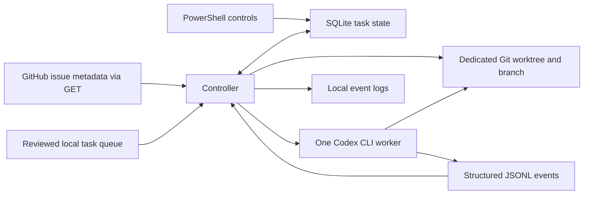

# Dallas Urbanists Agent Orchestrator

The orchestrator reads a local queue of reviewed tasks, starts one Codex CLI worker at a time, and saves the result of each run. Codex performs the work. The controller decides what can run next, gives each task its own Git branch and worktree, and keeps a local record so restarting the controller does not repeat a task.

## Set up on Windows

Install Node.js 24 or later, Git for Windows, and Codex CLI 0.163.0 or later. Install GitHub CLI if you want to poll GitHub issues. From PowerShell in this checkout, run the following commands.

```powershell
npm ci
codex login status
npm run doctor
npm test
npm run dry-run
```

Run `codex login` if you need to sign in. The doctor checks whether the CLI and its saved login are available. The integration test verifies that the signed-in account can actually run both models. If the doctor cannot find Codex, set `$env:ORCHESTRATOR_CODEX` to the absolute path to the native `codex.exe`. The npm PowerShell and batch shims are unsuitable for this subprocess runner.

Dry-run mode reads the sample issue queue and prints the prototype's simulated Terra and Sol assignments. It does not start Codex or create branches or a state database. A real run always uses one worker, even though the sample plan simulates three slots.

## Run the disposable integration test

```powershell
$env:ORCHESTRATOR_LIVE_TEST = '1'
try { npm run test:integration } finally { Remove-Item Env:ORCHESTRATOR_LIVE_TEST }
```

This test makes real Codex requests and can consume usage. It creates a fresh local Git repository, supplies fixture GitHub issue snapshots, and gives Terra and Sol separate worktrees. It checks that both file edits stay in their assigned worktrees, that both workers return structured results, and that the controller dispatches Sol automatically after Terra. It checks that Terra can pause for a decision while Sol completes independent work, then resume in its original worktree after an authorized fixture reply. Reopening the state leaves both completed claims and the unapproved issue alone. The Windows tests exercise cancellation, timeouts, and abrupt controller death against disposable subprocesses. The crash test verifies that a second controller cannot claim work while the first holds the lock, that a surviving worker keeps recovery on hold, and that only the independent queued task runs after recovery. The test prints the disposable folders and retains them for inspection.

The live worker also runs a synthetic filesystem probe that should return access denied when it tries to overwrite a file beside the worktree under Windows Temp. If the sentinel changes or the probe cannot establish the denial, the integration gate fails. This checks one write boundary on the host. The Windows worker currently uses the legacy unelevated workspace-write sandbox. Read access and network isolation have different limits, so keep the integration on disposable data. [Codex Windows sandbox](https://learn.chatgpt.com/docs/windows/windows-sandbox)

Set `ORCHESTRATOR_TEST_CHROME` to the absolute path of an installed Chromium executable to also run the Windows browser probe through a real worker. The probe checks a Node child process, a fresh browser profile, loopback navigation, and scratch cleanup. A profile write alone does not establish Chromium readiness.

On November 11, 2026, the disposable suite passed on Windows with Codex CLI 0.163.0, Node.js 24.22.1, and Git 2.50.1. The in-worktree writes succeeded and the sibling Temp write returned EPERM. This observation applies to the worker configuration used by the test.

## Run a reviewed local queue

Keep the initial real runs on disposable repositories. Leave Storytelling Studio and production checkouts outside the allowlist for this milestone. Use a trusted local queue file outside the task worktrees. Each task needs a unique positive number, an explicit `terra` or `sol` model, and a list of dependency numbers. A lower `priority` runs first. Ties go to the lower task number.

Save a queue such as the following as `queue.local.json`. Replace both paths with the absolute path of a disposable Git checkout that already has a commit.

```json
{
  "target": "C:/sandbox/disposable-demo",
  "allowedRepos": ["C:/sandbox/disposable-demo"],
  "issues": [
    {
      "number": 1,
      "title": "Add a demo note",
      "state": "ready",
      "model": "terra",
      "dependencies": [],
      "prompt": "Create demo.txt containing the text hello. Read it back to verify the edit."
    },
    {
      "number": 2,
      "title": "Add a second demo note",
      "state": "ready",
      "model": "sol",
      "dependencies": [1],
      "prompt": "Create second.txt containing the text world. Read it back to verify the edit."
    }
  ]
}
```

```powershell
npm run dry-run -- --queue queue.local.json --state .\state\demo
npm run start -- --queue queue.local.json --state .\state\demo --execute --limit 2 --timeout-seconds 300
```

For a local queue, dry-run lists tasks eligible now in dispatch order. Use the same state path for preview and execution so the preview accounts for previous task outcomes and pause or stop flags.

The controller snapshots the target's current committed HEAD at the start of each invocation. Every task in that invocation starts from that commit. A dependency's completion opens the scheduling gate. To use its edits as a later task's base, inspect and integrate them yourself before starting the later task. Use `--limit 1`, the default, when you need to review between tasks.

The allowlist matches the canonical checkout path. The controller keeps one state directory per checkout and requires it to sit outside the target checkout. It does not accept live GitHub issue bodies as executable tasks. It passes the operator-reviewed prompt as text on stdin, starts the CLI without a shell, and requests workspace-write with no approval escalation. The controller creates local branches. PR automation is future work.

Every worker attempt receives a fresh scratch directory at the root of its worktree. The runner sets `TEMP`, `TMP`, and `TMPDIR` for sandboxed commands so tools such as Chromium can create profiles there. Harnesses can use `ORCHESTRATOR_WORKER_TEMP` to restore those variables inside the test process if the sandbox supplies its own Temp values. The runner removes scratch after confirmed exit and retains it for inspection when termination is uncertain. The system Temp exclusion stays enabled. Terra runs at medium reasoning and Sol runs at high reasoning.

On the pilot host, legacy unelevated workers could write to scratch. Node child processes with piped output returned `spawn EPERM`, while file-backed output worked. Chromium started with file-backed output and created a profile, then exited with access-denied errors from Crashpad and Mojo IPC before navigation. In a disposable MXC comparison, Node started and profile creation passed, but Chromium still exited before navigation. Browser verification remains a coordinator step on that host.

## Poll GitHub issues and claim reviewed work

Sign in to GitHub CLI with `gh auth login` if needed. The poll command lists issue metadata using paginated GET requests. It omits pull requests and raw issue bodies and works without a target checkout.

```powershell
npm run poll -- --repo DallasUrbanists/agent-orchestrator
npm run poll -- --repo DallasUrbanists/agent-orchestrator --polls 3 --interval-seconds 15
```

A runnable issue needs the `agent:ready` label and exactly one of `model:terra` or `model:sol`. Optional priority labels are `priority:p0`, `priority:p1`, and `priority:p2`. An issue body can declare same-repository dependencies on one line such as `Depends on: #12, #13`. An issue closed as completed, an open issue labeled `agent:done`, or a completed local claim can satisfy a dependency. Missing or unresolved dependencies hold the dependent task. Conflicting labels and invalid dependency declarations hold the affected issue.

For real work, save a reviewed queue with `sourceRepo` and a local prompt for each approved issue number. Use a disposable Git checkout whose `origin` points to the same repository on github.com.

```json
{
  "target": "C:/sandbox/disposable-demo",
  "allowedRepos": ["C:/sandbox/disposable-demo"],
  "sourceRepo": "example-org/disposable-demo",
  "issues": [
    {
      "number": 12,
      "prompt": "Create demo.txt containing the text hello. Read it back to verify the edit."
    }
  ]
}
```

```powershell
npm run dry-run -- --queue queue.local.json --state .\state\github-demo
npm run start -- --queue queue.local.json --state .\state\github-demo --execute --limit 2 --polls 3 --interval-seconds 15
npm run status -- --state .\state\github-demo
```

The GitHub-backed controller refreshes issue metadata before each dispatch. It uses the local prompt verbatim as task content and uses GitHub metadata for readiness, model, priority, and dependencies. For a run, `--polls` limits consecutive polls with no eligible work and defaults to one. `--interval-seconds` is the delay between those idle polls. A failed GitHub read stops the run and preserves existing claims.

The controller binds the state directory to the checkout and `sourceRepo`. It records each issue claim in SQLite before creating the worktree or launching Codex. Keep using the same state directory on this machine. A task stays claimed across polls and restarts even if GitHub still shows it as ready. Local claims coordinate controllers that share this state directory. With the default options, GitHub operations are issue-list GET requests.

### Require accepted, integrated prerequisites

For a supervised queue that requires accepted work on the integration branch, add an `acceptedPrerequisites` array. Use an empty array when no prerequisites have been accepted yet. After verifying a prerequisite's checks and integration, record its issue number and the full commit SHA from the integration branch.

```json
"acceptedPrerequisites": [
  { "number": 5, "commit": "0123456789abcdef0123456789abcdef01234567" }
]
```

Start the controller from a checkout of the reviewed integration branch. The runner verifies that each listed commit is in the exact history used to create new worktrees. Each approved issue in a GitHub-backed queue must specify a reviewed `dependencies` array in this mode. Use `[]` for an issue with no prerequisites. The controller uses this array even when the GitHub issue body has no numeric dependency list. A GitHub issue state or a worker's local result cannot release dependent work in this mode. A receipt also prevents the accepted issue from dispatching again. The coordinator supplies the receipts and is responsible for matching the issue to the correct integrated change. Restart the run after updating the checkout and receipts. A blocked worktree must already contain the accepted prerequisite commits before it can resume. Use a new state directory when first switching an existing queue to this prerequisite policy.

## Ask for a decision on GitHub

Enable issue comments explicitly with `--github-decisions` on a real run. Use a GitHub-backed queue, a signed-in `gh` account with permission to comment on the target issues, and a local list of authorized GitHub account IDs. To find an account ID, run `gh api users/LOGIN --jq .id` and verify the account before adding it.

Add `authorizedResponders` to the queue and add reviewed decisions to the relevant issue entries. The worker can select each reviewed key once. GitHub receives the question, choice labels, and exact reply commands. Choice instructions stay local until the controller sends the chosen instruction to Codex.

```json
{
  "target": "C:/sandbox/disposable-demo",
  "allowedRepos": ["C:/sandbox/disposable-demo"],
  "sourceRepo": "example-org/disposable-demo",
  "authorizedResponders": [12345678],
  "issues": [
    {
      "number": 12,
      "prompt": "Build the draft index and ask for a layout decision before finishing.",
      "decisions": [
        {
          "key": "layout",
          "question": "Which layout should the draft index use?",
          "choices": [
            { "id": "list", "label": "List", "instruction": "Finish the draft using the reviewed list layout." },
            { "id": "grid", "label": "Grid", "instruction": "Finish the draft using the reviewed grid layout." }
          ]
        }
      ]
    }
  ]
}
```

```powershell
npm run start -- --queue queue.local.json --state .\state\github-demo --execute --github-decisions --limit 4 --polls 20 --interval-seconds 15
npm run status -- --state .\state\github-demo
```

The controller saves the blocked claim and request together, then posts the reviewed question on the issue. Independent tasks can run while the controller waits. From GitHub on mobile or desktop, add a new comment containing exactly one command from the request. The controller records the first matching, unedited reply from an authorized account. Before resuming, it checks the request and reply again against GitHub and the current account allowlist. If the saved reply was deleted, edited, or lost authorization, a newer valid reply can replace it. If GitHub comments are unavailable, the task stays blocked while unrelated eligible work can continue. Each resumption starts a fresh Codex session in the original worktree with all approved choice instructions saved for that task, in request order. The issue must remain ready, approved locally, and eligible under its dependencies. A successful resumption counts toward `--limit`. When the run reaches its poll limit, use the same command and state directory to check for replies again.

If a comment request times out, the controller checks later polls for the original message from the publishing account. Status shows `delivery-unconfirmed` when that check cannot confirm delivery. If you have inspected the issue and verified that the request was never posted, rearm that request with `node src/cli.js retry-decision REQUEST-ID --state .\state\github-demo`, then run the controller again. It checks for the original comment before posting. Keep the same signed-in publishing account during recovery.

## Pause, stop, and inspect

From another PowerShell window in the orchestrator checkout, use the same state path as the running controller.

```powershell
npm run status -- --state .\state\demo
npm run pause -- --state .\state\demo
npm run stop -- --state .\state\demo
Get-Content .\state\demo\logs\task-1.jsonl -Tail 20
```

Pause lets the current worker finish and prevents the next dispatch. Stop asks the controller to terminate the active process tree and prevents later dispatch. Ctrl+C asks the current controller to stop. On Windows, the controller uses `taskkill /T` for tree termination. On POSIX it signals the worker's process group and records an interruption because detached descendants may survive. Pause and stop set a durable control flag. Run `npm run unpause -- --state .\state\demo` and start the controller again when ready.

The controller stores task claims, timestamps, model, branch, worktree, PID, Codex session ID, terminal state, and diagnostic categories in SQLite. Logs record structured event types and exit codes. Controller logs and the database omit raw worker prompts, command output, and free-form model responses. Decision records retain the locally reviewed template, chosen option, and GitHub comment and responder IDs. Codex keeps its own session record under the signed-in user.

Status includes a durable attempt history for new dispatches. Each attempt records its base commit, model, log, process and session identifiers, and final outcome. Resuming a decision creates another attempt and preserves the earlier receipt. Existing task records remain readable after upgrade; history that predates this schema is unavailable.

A failed or blocked task leaves its worktree available if one was created. A controller logging or control-state failure ends the run. Dependencies wait, and independent tasks can continue within the run limit. The controller does not retry failed tasks automatically. After an abrupt restart, it marks the previous claim interrupted and holds dispatch because a worker might still be alive. Inspect the recorded worktree and PID, verify that the old worker and its children have exited, and then clear the hold with the following command. The acknowledgment command refuses to proceed if the recorded worker PID is still present or cannot be checked. A PID can be reused, so the controller never terminates a process from the saved number alone. Confirm that the worker's descendants have exited as well. Acknowledging the interruption never reruns that task.

```powershell
node src/cli.js acknowledge 1 --state .\state\demo --confirm-process-exited
```

Worktrees remain available for inspection by default. Use `node src/cli.js cleanup 1 --state .\state\demo` to remove a completed, clean worktree after review. The command refuses modified, untracked, or ignored files and keeps the task branch.

## Architecture



## Glossary

| Term | Meaning |
| --- | --- |
| Controller | The Node.js program that checks dependencies, starts workers, and records results. |
| Worker | One noninteractive Codex CLI process assigned to a task. |
| Issue queue | The local list of reviewed tasks and their dependencies. |
| Worktree | A separate checkout tied to a task branch, with Git history shared with the target repository. |
| Lease | The SQLite lock that lets only one controller dispatch from a state directory at a time. |
| Blocker | A decision or condition that prevents the worker from finishing the task. |
| Integration gate | The disposable test that checks whether this host can run both models and enforce the tested restrictions. |
